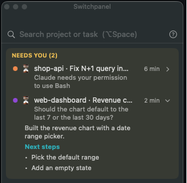

# Switchpanel

*[Read in English](README.md)*

Un tablero de sesiones para Claude Code: qué está haciendo cada terminal, en qué proyecto y cuenta, y cuáles te están esperando.

<p align="center"></p>

- **Panel flotante + ícono en la barra de menú** (macOS) con todas las sesiones abiertas, agrupadas por cuenta → proyecto. Las que esperan un permiso o una decisión suben arriba ("Te necesitan"), la que más espera primero.
- **Título de pestaña** con el color del proyecto y el estado: `🟠⏳ shop-api N+1 en GET…`. ⚙️ trabajando, ⏳ te espera, ✅ terminó (te toca).
- **Status line** en Claude Code con la cuenta, el proyecto y qué espera Claude de vos.
- **Clic en una fila para saltar a esa pestaña de Terminal**, o **⌥Espacio**, escribís `shop` y Enter.
- **Resúmenes opcionales**: al terminar cada turno, Haiku escribe qué se hizo y los próximos pasos.

En inglés y español. Requiere macOS 14+ y Terminal.app para saltar a las pestañas (los títulos y la status line andan en cualquier terminal).

## Instalación

Necesitás las Xcode Command Line Tools (`xcode-select --install`).

```bash
git clone https://github.com/emilianosuarez/switchpanel.git
cd switchpanel
./install.sh
```

El instalador:

- encuentra tus carpetas de config de Claude Code (`~/.claude`, `$CLAUDE_CONFIG_DIR` y cualquier `~/.claude-*` con config) y pregunta antes de tocarlas,
- hace backup de cada `settings.json` (`settings.json.switchpanel-backup-<hora>`) y **combina** sus hooks sin tocar los tuyos,
- respeta tu status line si ya tenés una (`--statusline` la reemplaza; al desinstalar vuelve),
- copia el hook a `~/.switchpanel/bin/` y agrega los comandos `/label` y `/proyecto`,
- compila la app y la instala en `~/Applications`.

Después reiniciá tus sesiones de Claude Code. La primera vez que hagas clic en una fila, macOS pide permiso para controlar Terminal.

Opciones: `--language auto|en|es`, `--summaries on|off`, `--config-dir DIR` (repetible), `--statusline`, `--no-app`, `--link` (corre el hook desde el repo, para desarrollo), `--dry-run`, `--yes`.

### Desinstalar

```bash
./uninstall.sh           # saca hooks, comandos y la app; deja ~/.switchpanel
./uninstall.sh --purge   # además borra ~/.switchpanel
```

## Comandos

Se escriben en Claude Code. Los intercepta el hook, así que no llegan al modelo ni consumen tokens.

- `/label feature A`: etiqueta la sesión (`/label` sola la borra).
- `/proyecto Mi API azul`: renombra el proyecto y/o le cambia el color. También anda `/project`. Colores: azul, verde, naranja, violeta, rosa, turquesa, amarillo, rojo, gris (o en inglés).

En el panel: clic en un proyecto para renombrarlo, clic derecho para el color, posponer una sesión o renombrar una tarea.

## Resúmenes

<p align="center"></p>

Vienen apagados. Si los activás, al terminar cada turno el hook corre `claude -p --model haiku` **con la misma cuenta de la sesión y sin `ANTHROPIC_API_KEY`**, así que usa la cuota de tu plan y no la API. Se activan con `./install.sh --summaries on` o en `~/.switchpanel/config.json`:

```json
"summaries": {"enabled": true, "model": "haiku"}
```

## Configuración

`~/.switchpanel/config.json` (en la barra de menú está "Abrir config.json"):

```json
{
  "language": "auto",
  "accounts": {
    ".claude": {"name": "Empresa", "emoji": "🏢", "color": "blue"},
    ".claude-personal": {"name": "Personal", "emoji": "🏠", "color": "green"}
  },
  "projects": {
    "/Users/yo/code/shop-api": {"name": "shop-api", "color": "orange", "short": "shop"}
  },
  "summaries": {"enabled": false, "model": "haiku"}
}
```

- `language`: `auto` sigue a macOS; `en` o `es` lo fuerza para el hook y la app. Lo más fácil es desde la barra de menú: Idioma → English / Español (la app se reinicia sola).
- `accounts` va por carpeta de config; cada cuenta se registra sola la primera vez que arranca una sesión.
- `projects` va por raíz git; los nuevos reciben un color libre. `short` es un nombre corto opcional para el título de la pestaña.

El estado de cada sesión está en `~/.switchpanel/sessions/` y los errores en `~/.switchpanel/switchpanel.log`.

## Cómo funciona

`hooks/switchpanel.py` corre como hook de Claude Code y escribe el estado de cada sesión en `~/.switchpanel/sessions/<session_id>.json`:

| Evento | Estado |
|---|---|
| SessionStart | `idle`: registra cuenta, proyecto (raíz git), tty |
| UserPromptSubmit | `working` (o procesa `/label` y `/proyecto` sin llamar al modelo) |
| PostToolUse | vuelve a `working` tras un permiso |
| Notification | `waiting_permission` / `waiting_input` |
| Stop | `done` + resumen en segundo plano si está activado |
| SessionEnd | `ended` |

Escribe el título de la pestaña directo en la tty de la sesión (OSC 0) y define `CLAUDE_CODE_DISABLE_TERMINAL_TITLE=1` para que Claude Code no lo pise.

La app (`app/`, SwiftUI) observa esa carpeta. Para recompilarla mientras desarrollás: `app/scripts/build-app.sh`. Para capturas, `scripts/demo.py` la abre con sesiones inventadas.

Los archivos de sesión tienen un formato chico y documentado ([docs/session-format.md](docs/session-format.md)), así que se pueden sumar otros agentes de código escribiendo un adaptador que los genere, sin cambiar la app.

---

Switchpanel es un proyecto independiente, sin relación con Anthropic ni avalado por ella. Claude y Claude Code son marcas de Anthropic.

## Licencia

[MIT](LICENSE)
