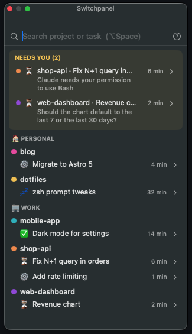

# Switchpanel

*[Leer en español](README.es.md)*

A session board for Claude Code: what each terminal is doing, in which project and account, and which ones are waiting for you.

<p align="center"></p>

- **Floating panel + menu bar icon** (macOS) listing every open session, grouped by account → project. Sessions waiting for a permission or a decision float to the top ("Needs you"), oldest first.
- **Tab titles** that show the project color and state: `🟠⏳ shop-api fix N+1…`. ⚙️ working, ⏳ waiting for you, ✅ done (your turn).
- **Status line** in Claude Code with the account, project and what Claude is waiting for.
- **Click a row to jump to that Terminal tab**, or press **⌥Space**, type `shop` and hit Enter.
- **Optional summaries**: after each turn, Haiku writes what was done and the next steps.

English and Spanish. Requires macOS 14+ and Terminal.app for jumping to tabs (titles and the status line work in any terminal).

## Install

You need the Xcode Command Line Tools (`xcode-select --install`).

```bash
git clone https://github.com/emilianosuarez/switchpanel.git
cd switchpanel
./install.sh
```

The installer:

- finds your Claude Code config folders (`~/.claude`, `$CLAUDE_CONFIG_DIR` and any `~/.claude-*` with a config in it) and asks before touching them,
- backs up each `settings.json` (`settings.json.switchpanel-backup-<time>`) and **merges** its hooks in, leaving your other hooks alone,
- keeps your status line if you already have one (`--statusline` replaces it; uninstalling brings it back),
- copies the hook to `~/.switchpanel/bin/` and adds the `/label` and `/project` commands,
- builds the app and installs it in `~/Applications`.

Restart your Claude Code sessions afterwards. The first time you click a row, macOS asks for permission to control Terminal.

Options: `--language auto|en|es`, `--summaries on|off`, `--config-dir DIR` (repeatable), `--statusline`, `--no-app`, `--link` (run the hook from the repo, for development), `--dry-run`, `--yes`.

### Uninstall

```bash
./uninstall.sh           # removes hooks, commands and the app; keeps ~/.switchpanel
./uninstall.sh --purge   # also deletes ~/.switchpanel
```

## Commands

Typed in Claude Code. The hook intercepts them, so they don't reach the model or use tokens.

- `/label feature A`: labels the session (`/label` alone clears it).
- `/project My API blue`: renames the project and/or changes its color. `/proyecto` works too. Colors: blue, green, orange, purple, pink, teal, yellow, red, gray (or their Spanish names).

In the panel: click a project to rename it, right-click for colors, snooze a session, or rename a task.

## Summaries

Off by default. When on, after each turn the hook runs `claude -p --model haiku` **with the same account as the session and without `ANTHROPIC_API_KEY`**, so it uses your plan's quota, not the API. Turn them on with `./install.sh --summaries on` or in `~/.switchpanel/config.json`:

```json
"summaries": {"enabled": true, "model": "haiku"}
```

## Configuration

`~/.switchpanel/config.json` (the menu bar has "Open config.json"):

```json
{
  "language": "auto",
  "accounts": {
    ".claude": {"name": "Work", "emoji": "🏢", "color": "blue"},
    ".claude-personal": {"name": "Personal", "emoji": "🏠", "color": "green"}
  },
  "projects": {
    "/Users/me/code/shop-api": {"name": "shop-api", "color": "orange", "short": "shop"}
  },
  "summaries": {"enabled": false, "model": "haiku"}
}
```

- `language`: `auto` follows macOS; `en` or `es` forces it for both the hook and the app. Easiest from the menu bar: Language → English / Español (the app restarts itself).
- `accounts` are keyed by config folder and get registered automatically the first time a session starts.
- `projects` are keyed by git root; new ones get a free color. `short` is an optional short name for the tab title.

Session state lives in `~/.switchpanel/sessions/`; errors go to `~/.switchpanel/switchpanel.log`.

## How it works

`hooks/switchpanel.py` runs as a Claude Code hook and writes each session's state to `~/.switchpanel/sessions/<session_id>.json`:

| Event | State |
|---|---|
| SessionStart | `idle`: records account, project (git root), tty |
| UserPromptSubmit | `working` (or handles `/label` and `/project` without calling the model) |
| PostToolUse | back to `working` after a permission |
| Notification | `waiting_permission` / `waiting_input` |
| Stop | `done`, plus a background summary if enabled |
| SessionEnd | `ended` |

It writes the tab title straight to the session's tty (OSC 0) and sets `CLAUDE_CODE_DISABLE_TERMINAL_TITLE=1` so Claude Code doesn't overwrite it.

The app (`app/`, SwiftUI) watches that folder. To rebuild it during development: `app/scripts/build-app.sh`. For screenshots, `scripts/demo.py` opens it with made-up sessions.

The session files are a small, documented format ([docs/session-format.md](docs/session-format.md)), so other coding agents can be supported by writing an adapter that produces them. The app doesn't need to change.

---

Switchpanel is an independent project, not affiliated with or endorsed by Anthropic. Claude and Claude Code are trademarks of Anthropic.

## License

[MIT](LICENSE)
